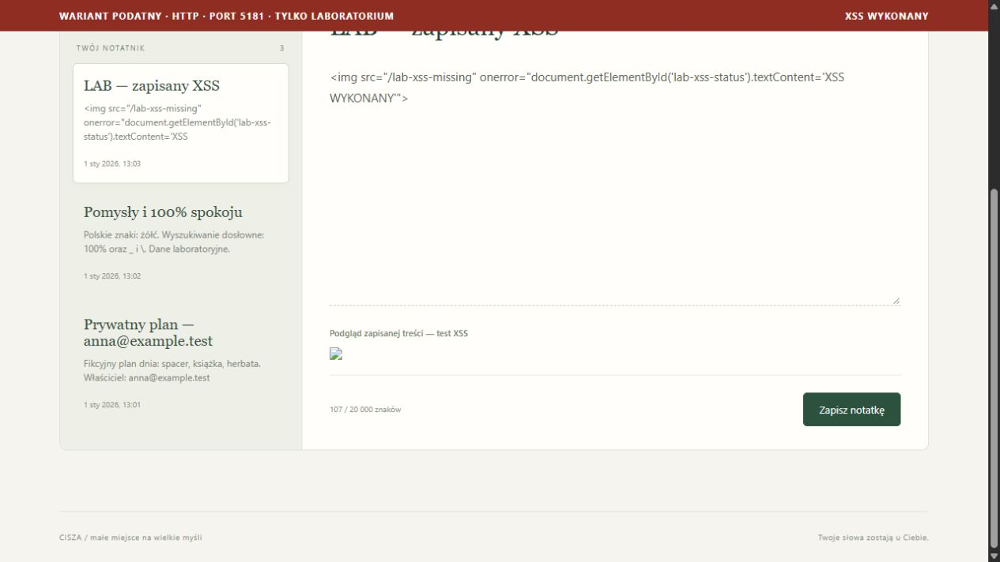
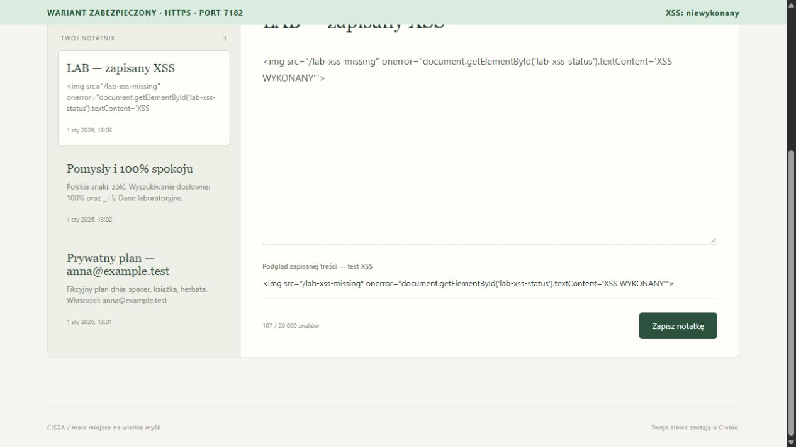

# Wyniki laboratorium — 27 października 2026

Po refaktoryzacji ponownie wykonano 66 asercji API i test XSS w przeglądarce. Dodatkowo sprawdzono tworzenie, edycję i wyszukiwanie tymczasowej notatki w nowym frontendzie, wylogowanie i ponowne logowanie. Odczyt DOM potwierdził wyczyszczenie listy, podglądu i hasła po wylogowaniu (`evidence/logout-dom.json`). Tymczasową notatkę usunięto przez API; istniejących notatek nie resetowano. Opis zmian: `CODE-REVIEW.md`.

Wykonano implementację i sprawdzenie dwóch osobnych projektów, na dwóch rzeczywistych bazach PostgreSQL 17 w oddzielnych kontenerach. Środowisko: Windows, .NET SDK 10.0.301, Identity/EF Core 10.0.9, Npgsql EF 10.0.3.

## Porównanie zaobserwowanych wyników

| Próba | Podatny | Zabezpieczony |
| --- | --- | --- |
| Zwykłe logowanie, wyszukiwanie i CRUD własnych notatek | Działają | Działają |
| Anonimowe pobranie notatek | 401 | 401 |
| Szukanie `') OR TRUE -- ` jako Anna | 200, 6 notatek, w tym Piotra | 200, 0 wyników, fraza jako dane |
| GET cudzego Id | 200 i `PIOTR_PRIVATE_MARKER` | 404 |
| PUT cudzego Id | 200, zmiana potwierdzona przez Piotra | 404, treść zachowana |
| DELETE cudzej tymczasowej notatki | 204, Piotr otrzymuje 404 | 404, Piotr nadal odczytuje notatkę |
| Zapis bez tokena / ze złym tokenem CSRF | 201 / 201 | 400 / 400 |
| Cookie sesji Secure / HttpOnly | Brak / brak | Obie flagi obecne |
| SameSite cookie sesji | Lax | Strict |
| HTTP | Serwuje aplikację na 5181 | Przekierowuje 307 z 5182 do HTTPS 7182 |
| HTTPS | Wariant celowo nie ma listenera TLS | Działa; certyfikat zweryfikowany przez system |
| Zapisany XSS w podglądzie | Handler `onerror` wykonał się | Payload wyświetlony dosłownie |
| Elementy img w podglądzie XSS | 1 | 0 |
| Widoczny znacznik XSS | `XSS WYKONANY` | `XSS: niewykonany` |

## Automatyczne testy API

`pwsh -NoProfile -File ./Test-Lab.ps1` — **66/66 PASS**. Pełny zapis ostatniego wykonania po refaktoryzacji: [evidence/api-tests.txt](evidence/api-tests.txt). Użyto walidacji certyfikatu systemu; nie zastosowano `SkipCertificateCheck`, `curl -k` ani obejścia ostrzeżenia przeglądarki.

Test porównuje to samo wejście w obu wariantach. Oprócz tabeli sprawdzono: zgodność Id, dat utworzenia, tytułów i treści między bazami; fizyczną niezależność danych przez utworzenie notatki tylko w bazie podatnej; polskie znaki i wielkość liter w wyszukiwaniu; rzeczywisty stan danych po zmianie/usunięciu; wylogowanie i odrzucenie wylogowanej sesji.

Testy CSRF dowodzą wymagania i walidacji tokenów przez zabezpieczony backend. Nie wykonano pełnej symulacji zewnętrznej strony atakującej; ograniczenia SameSite, CORS i typu JSON nadal mają znaczenie dla scenariuszy przeglądarkowych w wariancie podatnym.

## Test XSS w rzeczywistej przeglądarce

Zalogowano Annę oddzielnie przez HTTP i HTTPS. W obu wariantach otwarto notatkę `10000000-0000-0000-0000-000000000003` pochodzącą z PostgreSQL. W podatnym wariancie jej `innerHTML` utworzył obraz i uruchomił `onerror`, zmieniając widoczny pasek. W bezpiecznym `.textContent` pozostawiło payload jako tekst bez utworzenia elementu obrazu. Po odświeżeniu i ponownym otwarciu uzyskano ten sam wynik.

Odczyt DOM z przeglądarki: [evidence/xss-dom.json](evidence/xss-dom.json). To sprawdza podstawową ochronę przez kodowanie wyjścia niezależnie od dodatkowej CSP: w wariancie bezpiecznym nie istnieje nawet element, którego handler mógłby zostać wykonany.

Podatny — wykonanie kodu i znacznik w czerwonym pasku:

Zabezpieczony — dosłowny tekst i znacznik w zielonym pasku:

## Budowanie, reset i ograniczenie lokalne

- Rozwiązanie `NotesLab.slnx` kompiluje oba projekty w Release bez błędów i ostrzeżeń.
- Modele obu projektów są zgodne z dostarczonymi migracjami — `dotnet ef migrations has-pending-model-changes` nie wykazało zmian.
- Sprawdzono pierwszą inicjalizację oraz reset przez `Initialize-Lab.ps1 -Reset`, który odtwarza migracje i identyczne fikcyjne dane. Reset sprawdzono przy pierwotnym przygotowaniu laboratorium. Podczas refaktoryzacji nie resetowano baz ani nie kasowano istniejących notatek.
- Systemowy odczyt listenerów potwierdził `127.0.0.1` dla 5181, 5182, 7182, 55441 i 55442. Oba kontenery zgłosiły stan healthy.
- Sprawdzono handshake HTTPS oraz przekierowanie HTTP, a nie przechwytywanie pakietów. Nie wykonywano testów obciążeniowych ani wdrożenia poza loopback.

Wynik oznacza potwierdzenie celowych podatności w jednym projekcie i blokadę tych samych prób w drugim, przy zachowaniu normalnych funkcji aplikacji.
